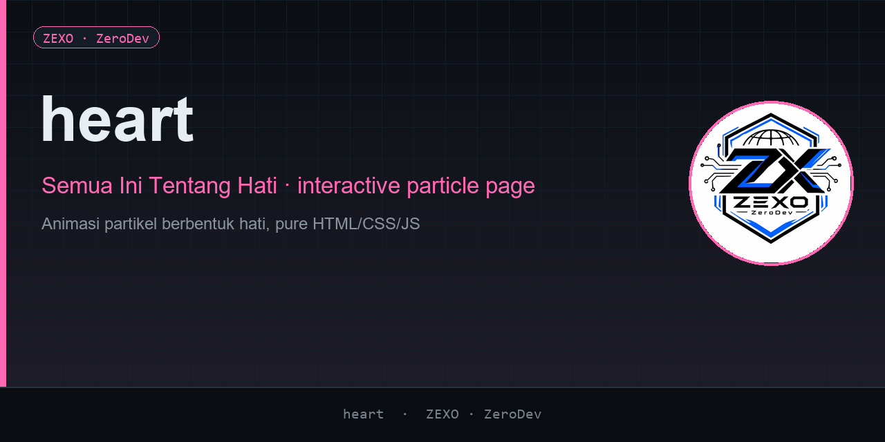

  

  

<h1 align="center">heart</h1>

Animasi partikel berbentuk hati, pure HTML/CSS/JS

  
  
  
  

---

## Tentang

Halaman web sederhana dengan animasi partikel berbentuk hati. Judul: *Semua Ini Tentang Hati*.

## Struktur

- `function-heart.html` — halaman utama
- `script.js` — logika partikel
- `style.css` — gaya

## Jalankan

Buka `function-heart.html` di browser.
